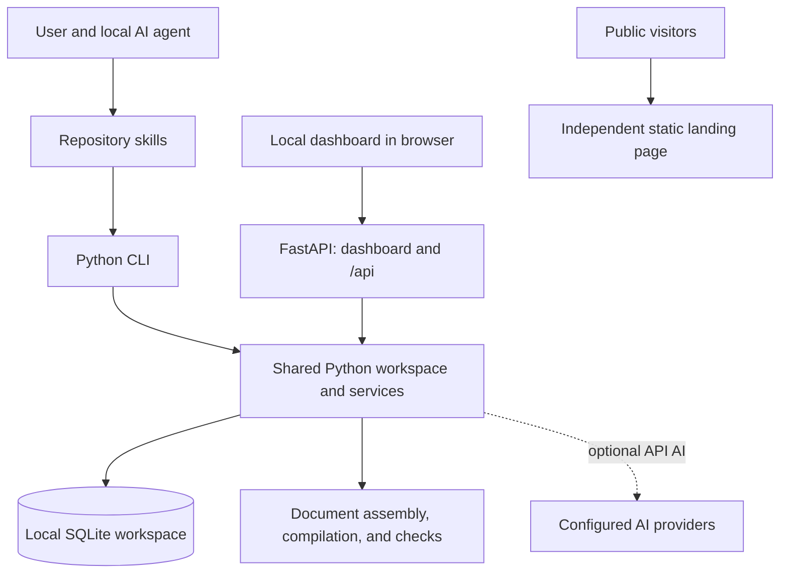

# CV Tailor

A local career workspace for your AI agent, with an optional dashboard. Import your experience, tailor one-page resumes and cover letters, research jobs, prepare for interviews, and track applications in a SQLite database on your machine.

Your agent handles reasoning and writing; CV Tailor provides persistent records, typed inputs and outputs, document rendering, and reviewable drafts. Use an agent that can read repository skills and run shell commands, such as Codex, Claude Code, OpenCode, or Antigravity. Browsing and employer-form assistance depend on the tools available in that agent session.

**Start with Python 3.12+ and Git.** CLI use requires no CV Tailor account, AI API key, Node.js, Docker, or database server. Your chosen agent supplies its own AI access. The dashboard and built-in provider AI are optional.

## Contents

- [What you can do](#what-you-can-do)
- [Architecture and repository map](#architecture-and-repository-map)
- [Requirements](#requirements)
- [Install and start](#install-and-start)
- [Optional dashboard](#optional-dashboard)
- [CLI workflow](#cli-workflow)
- [Data, preferences, and backups](#data-preferences-and-backups)
- [Optional capabilities and configuration](#optional-capabilities-and-configuration)
- [Development and verification](#development-and-verification)
- [Instructions for AI agents](#instructions-for-ai-agents)
- [Troubleshooting](#troubleshooting)
- [Further documentation](#further-documentation)
- [License](#license)

## What you can do

| Task | What CV Tailor provides | Agent skills |
| --- | --- | --- |
| Maintain your profile | Experience, education, projects, certifications, and confirmed skills | [cv-profile](.agents/skills/cv-profile/SKILL.md) |
| Find and assess jobs | URL/description intake, requirement comparisons, sourced research | [cv-jobs](.agents/skills/cv-jobs/SKILL.md), [cv-job-fit](.agents/skills/cv-job-fit/SKILL.md), [cv-company-research](.agents/skills/cv-company-research/SKILL.md) |
| Tailor documents | One-page resumes, targeted edits, cover letters, draft history, exports | [cv-resume](.agents/skills/cv-resume/SKILL.md), [cv-resume-edit](.agents/skills/cv-resume-edit/SKILL.md), [cv-cover-letter](.agents/skills/cv-cover-letter/SKILL.md) |
| Track applications | Statuses, notes, follow-ups, archives, documents, pipeline snapshots | [cv-tracker](.agents/skills/cv-tracker/SKILL.md), [cv-snapshot](.agents/skills/cv-snapshot/SKILL.md) |
| Assist with forms | Recoverable answers and checkpoints tied to selected documents | [cv-apply](.agents/skills/cv-apply/SKILL.md), [cv-browser](.agents/skills/cv-browser/SKILL.md) |
| Prepare for interviews | Plans, practice feedback, cheat sheets, Python exercises | [cv-interview](.agents/skills/cv-interview/SKILL.md), [cv-code-practice](.agents/skills/cv-code-practice/SKILL.md) |
| Connect your tools | Guided setup for notes, spreadsheets, CRMs, calendars | [cv-connect](.agents/skills/cv-connect/SKILL.md), [cv-calendar](.agents/skills/cv-calendar/SKILL.md) |

Start multi-step career work with [cv-tailor](.agents/skills/cv-tailor/SKILL.md). It loads saved context and routes work to focused skills. Confirm extracted facts before saving your profile or using them in applications.

Eight visual resume Templates are available: **Classic, Modern, Minimal, Serif, Executive, Technical, Compact, and Sidebar**. A **Preset** steers content for a professional role; a **Template** controls appearance. They are independent. Run `cv-tailor --json templates list` for template IDs.

## Architecture and repository map

CV Tailor has three parts:

1. **Python CLI:** the default interface for agents and terminal users. It works without a running server.
2. **Optional dashboard:** a static Next.js export served by FastAPI together with `/api` endpoints, from one Python process on localhost. It shares the CLI's SQLite workspace.
3. **Public landing page:** a separately built static Next.js site explaining the product. It does not host career data or the local API.



In default **external-agent mode**, skills export saved context and a JSON output schema. Your agent prepares structured content and imports it through the CLI. CV Tailor validates it, saves a draft, and renders documents where applicable. **API mode** explicitly enables provider calls for supported dashboard workflows.

SQLite uses foreign keys, WAL, and short write transactions shared across CLI and dashboard processes. Revision checks protect edits, and request receipts make identical create/import retries safe. Slow compilation and provider work happen outside write transactions.

Resume content is plain-text JSON. Python assembles LaTeX and compiles it with Tectonic or an available XeLaTeX installation. The AI does not generate LaTeX. PDF checks enforce the one-page rule and report ATS warnings. An ATS Check evaluates document formatting; it is not a numerical match score or hiring prediction.

The dashboard resume editor offers structured fields, PDF preview, and raw LaTeX over the same LaTeX source. A **Spot Edit** rewrites a contiguous run of Blocks within one Section while preserving unrelated content; see the domain rules in [CONTEXT.md](CONTEXT.md).

```text
CV-Tailor/
├── ai-service/
│   ├── pyproject.toml           # Python package, CLI entrypoint, optional extras
│   ├── cv_tailor/
│   │   ├── cli.py              # Command-line adapter
│   │   ├── workspace.py        # Shared operations and draft lifecycle
│   │   ├── config.py           # Workspace path, environment, capabilities
│   │   ├── database.py         # SQLite engine and sessions
│   │   ├── schema_changes.py   # Versioned upgrades and Preset seeds
│   │   ├── main.py             # FastAPI app and local access checks
│   │   ├── dashboard.py        # Dashboard packaging and launcher
│   │   ├── browser*.py         # Optional browser adapter, wizard, MCP
│   │   ├── models/             # Persistence and typed content schemas
│   │   ├── routers/            # HTTP adapters mounted under /api
│   │   ├── services/           # Career tasks, documents, providers, execution
│   │   └── sandbox/            # Optional Docker workers and image
│   └── tests/                  # Backend and CLI tests
├── frontend/                   # Optional dashboard: Next.js, React, TypeScript
│   ├── src/app/(workspace)/    # Profile, tracker, documents, practice, insights
│   ├── src/components/         # Shared interface components
│   ├── src/lib/                # API helpers, caches, resume editing, state
│   └── tests/                  # Unit and Playwright browser tests
├── landing/                    # Independent public product site
├── .agents/skills/cv-*/         # Canonical career workflows
├── .claude/skills/cv-*/         # Generated Claude entrypoints
├── scripts/                    # Installer, hooks, skill sync, assets
├── .github/workflows/          # Backend and static-build CI
├── .githooks/                  # Guards against direct main commits/pushes
├── docs/                       # Guides, ADRs, historical plans
├── AGENTS.md                   # Repository operating instructions
└── CONTEXT.md                  # Domain language and architectural constraints
```

A checkout may have an older folder name such as `CV Tailor Go`; the current application is Python and Next.js. No Go PDF service is required. The active Python package is `ai-service/cv_tailor`.

## Requirements

| Component | Needed for |
| --- | --- |
| Git | Cloning and updating |
| Python 3.12+ with `pip` and `venv` | All installations |
| AI agent with shell access | Guided career workflows in external-agent mode |
| Node.js 22+ and npm | Building the optional dashboard or landing page |
| Network access | Dependency installation, first-use TeX package downloads, online research/job sources |
| Playwright and a supported browser | Optional application browser adapter or browser tests |
| Python Tk support | Optional native sign-in wizard |
| Poppler: `pdftoppm`, `pdftotext` | Regenerating resume gallery assets |
| Docker with a Linux engine | Explicit Docker execution mode and its opt-in tests |

Node.js is unnecessary for CLI-only use or serving an already packaged dashboard. The base Python package includes the Tectonic integration through `tecto`; a full TeX installation is optional. On Linux, `pip`, `venv`, and Tk may be separate distribution packages.

## Install and start

Run from a terminal, using `python3` instead of `python` if that names your Python 3.12+ installation:

```sh
git clone https://github.com/yabswannalearn/CV-Tailor.git
cd CV-Tailor
python scripts/install.py --cli-only
```

The installer creates a repository `.venv`, installs the package in editable mode, and initializes the workspace. Running `python scripts/install.py` interactively offers CLI-only or CLI + dashboard; CLI-only is the default. To build the dashboard immediately, install Node.js 22+ and use `--with-dashboard` instead.

Activate the environment in each new terminal:

```powershell
# Windows PowerShell, from the repository root
.venv\Scripts\Activate.ps1
```

```sh
# macOS / Linux, from the repository root
. .venv/bin/activate
```

Check the installation:

```sh
cv-tailor --json status
cv-tailor doctor
cv-tailor --json preferences get
```

`status` should report `initialized: true`, the workspace path, and available capabilities. `ai.mode: "external"` and `dashboard_installed: false` are expected for a fresh CLI-only install. `doctor` reports Python, Node, execution mode, and compiler availability.

Without activation, use these executables or the environment's Python with `-m cv_tailor`:

| Platform | CLI | Python |
| --- | --- | --- |
| Windows | `.venv/Scripts/cv-tailor.exe` | `.venv/Scripts/python.exe` |
| macOS / Linux | `.venv/bin/cv-tailor` | `.venv/bin/python` |

The remaining examples assume an active virtual environment and the repository root as the working directory.

### Your first career task

Open your agent in this checkout and provide your CV and a job description or URL. For example:

> Read AGENTS.md and use .agents/skills/cv-tailor/SKILL.md. Load my saved workspace first. Help me import my CV, confirm my profile facts, compare this job with my experience, and save a tailored resume and cover letter as drafts for the application.

The agent should reuse your saved profile and preferences in later sessions. If its host does not discover repository skills automatically, give it the skill path explicitly. The CLI can also be used directly, but does not supply external-agent reasoning itself.

## Optional dashboard

With Node.js 22+ and npm installed:

```sh
cv-tailor dashboard install
cv-tailor dashboard
```

`dashboard install` installs the Python dashboard extra, runs `npm ci` and the production build in `frontend/`, and copies `frontend/out` into the Python package's static assets. It does not enable built-in AI.

Open [the local dashboard](http://127.0.0.1:8000). The launcher opens a browser automatically; stop it with Ctrl+C. For another port or a terminal-only launch:

```sh
cv-tailor dashboard --port 8001 --no-open
```

In external-agent mode, use **Work with your CLI agent → Copy agent prompt**, paste it into your agent in this checkout, and save the result through the CLI. The dashboard reads the same saved records. Review a draft before selecting it as the current application document.

The API provides [health](http://127.0.0.1:8000/api/health) and [interactive documentation](http://127.0.0.1:8000/api/docs). Keep the server on localhost: this single-user application has no account authentication and accepts local, same-origin requests. The public landing page is deployed independently.

## CLI workflow

Commands accept `--json` and `--data-dir` before or after subcommands. Errors return nonzero exit codes and structured output in JSON mode. Inputs accept a JSON filename or `--input -` for stdin; prefer these over shell-escaped JSON.

```sh
cv-tailor --help
cv-tailor applications --help
cv-tailor drafts import --help
cv-tailor schema profile
cv-tailor schema application
cv-tailor schema resume
```

### From profile to application documents

1. **Load or import your profile.** Have the agent extract selectable CV text and prepare `profile.json` using `schema profile`. Confirm the facts before import:

   ```sh
   cv-tailor profile extract-text /absolute/path/cv.pdf
   cv-tailor profile import --input profile.json
   cv-tailor --json profile get
   ```

   Importing over an existing profile requires its current `--revision`. Scanned PDFs need agent OCR tools or user-supplied text.

2. **Save a job.** Prepare `job.json` with the actual posting. This illustrative minimum should be replaced with your job details:

   ```json
   {
     "company_name": "Example Company",
     "job_title": "Software Developer",
     "job_description": "Paste the actual job description here.",
     "status": "Saved"
   }
   ```

   ```sh
   cv-tailor applications add --input job.json --request-id unique-job-create-id
   cv-tailor applications list --archived no
   cv-tailor applications get 1
   ```

   Replace `1` below with the returned application ID. A Job Source is where you found the role; it is distinct from `job_url` and may be unknown.

3. **Export context and import the agent's result.** Context contains saved facts, job details, preferences, previous drafts, evidence, instructions, and the output schema:

   ```sh
   cv-tailor --json context export --task resume --application 1
   cv-tailor drafts import --kind resume --application 1 --input resume.json --request-id unique-resume-import-id
   cv-tailor drafts import --kind cover_letter --application 1 --input cover-letter.json --request-id unique-letter-import-id
   cv-tailor drafts list --application 1
   ```

   The agent prepares `resume.json` and `cover-letter.json` using their schemas. These imports validate and save results without calling a model.

4. **Review, check, export, and select documents.** Draft IDs differ from application IDs. Here `2` is an example resume draft ID:

   ```sh
   cv-tailor drafts get 2
   cv-tailor resume check 2
   cv-tailor drafts export 2 --format pdf --output resume.pdf
   cv-tailor drafts export 2 --format docx --output resume.docx
   cv-tailor applications get 1
   cv-tailor drafts apply 2 --revision 1
   ```

   Use the application's latest revision, not the example value `1`. Applying a resume or cover-letter draft selects its current document and retains earlier drafts. It does not submit an employer form or mark the job Applied. Export formats depend on draft kind; see the focused document skill.

### Other useful commands

```sh
cv-tailor jobs fetch https://example.com/job
cv-tailor jobs search "Python developer"
cv-tailor applications list --status Interview
cv-tailor applications stats
cv-tailor applications insights
cv-tailor applications insights --include-archived
cv-tailor resume blocks 2
cv-tailor forms prepare --application 1 --resume 2
cv-tailor practice problems
```

Job-source availability varies; search returns source diagnostics. URL intake or pasted descriptions remain available. For portable reports, ask **“Use cv-snapshot to visualize my application pipeline.”** It saves an SVG, standalone HTML, and source JSON under the workspace's `snapshots/` directory without a dashboard server.

### Facts, revisions, and retries

- Personal claims must come from confirmed profile facts or explicit user statements. Job requirements, suggested skills, generated documents, and web pages do not establish personal evidence.
- New conversation facts can be passed as a JSON list with `--evidence facts.json` on draft import/revise, resume patch, or practice save. They remain scoped to that conversation/application; saving them to the profile is a separate choice.
- Edits to profiles, preferences, and applications require current revisions. Archive, restore, delete, and selecting current documents require the application revision. On conflict, reread and reconcile.
- Reuse a request ID only for an identical create/import retry. A different payload needs a new ID. Request receipts prevent duplicate creates/imports.
- Overflow resumes remain reviewable drafts, but selecting a resume as current or exporting its PDF requires exactly one page. Resolve overflow using supported content; do not invent achievements or numbers.

## Data, preferences, and backups

The default workspace lives outside the checkout:

```text
~/.cv-tailor/
├── cv-tailor.sqlite3        # Profile, applications, drafts, preferences, receipts
├── .env                    # Optional runtime/provider settings
├── browser/                # Optional per-site profiles and staged files
└── snapshots/              # Reports generated on request
```

On Windows, `~` is your user profile directory. `status` prints the absolute path. Each workspace has one career profile; its email is contact information, not a login. Multiple clones share this default workspace, and repository updates do not remove it. Agent-host chat histories remain in that host; CV Tailor stores records and results saved through its own interfaces.

Storage is local; your selected AI agent/provider may process the context you supply to it. Online research, job sources, and optional publishing also contact their respective services.

Use `--data-dir` or `CV_TAILOR_HOME` for another workspace. The command-line choice takes precedence. Pass the same directory to every related command and dashboard launch:

```sh
python scripts/install.py --cli-only --data-dir /absolute/path/career-workspace
cv-tailor --data-dir /absolute/path/career-workspace --json status
cv-tailor --data-dir /absolute/path/career-workspace dashboard
```

`init` creates and seeds SQLite automatically; schema upgrades back up an existing versioned database before changes. Normal setup needs no separate migration command. Importing legacy hosted PostgreSQL accounts is not implemented.

For manual backups, stop the dashboard and other writers, then copy the whole workspace directory to a private backup location. Restore the complete backup while those processes are stopped. Back up integration configuration and credentials separately if used. Browser profiles contain authenticated session data; protect backups accordingly.

### Remembered preferences

Read `cv-tailor --json preferences get` and reuse the saved defaults. Create a nonsecret `preferences.json` to update selected fields:

```json
{
  "resume_template": "modern",
  "tracking_connection": { "provider": "notion", "config_path": null }
}
```

```sh
cv-tailor --json preferences set --revision 1 --input preferences.json
```

Replace `1` with the current preference revision. Application-specific templates override the default; changing the default does not rewrite existing applications. `"tracking_connection": null` chooses SQLite-only tracking.

`calendar_connections` separately supports one `googlecalendar` and one `outlook` connection. Each stores a provider and absolute path to a nonsecret JSON setup file, or `null` before setup. Preserve the latest list when changing one provider; `[]` clears remembered calendars. Disconnecting a preference does not revoke authorization or delete calendar events.

Credentials never belong in preferences. Remembering a provider or setup file does not prove the connection works or authorize publishing.

## Optional capabilities and configuration

### Built-in API AI

External-agent mode needs no provider configuration in CV Tailor. To opt into built-in AI, install the extra:

```sh
python -m pip install -e "ai-service[ai]"
```

Create `.env` in your selected workspace, normally `~/.cv-tailor/.env`:

```env
AI_MODE=api
AI_PROVIDER=gemini
GEMINI_API_KEY=your-key
# Standalone generation can instead use:
# AI_PROVIDER=openai
# OPENAI_API_KEY=your-key
# Optional job-search ranking:
# JEV_API_KEY=your-key
```

Built-in Career Agent and Google Search research require Gemini; standalone generation supports Gemini or OpenAI. Setting a key alone does not enable API mode. Model defaults live in provider services; `GEMINI_MODEL` and `OPENAI_MODEL` override standalone generation defaults. Restart the dashboard after changes and inspect `status` for enabled capabilities.

| Setting | Default / purpose |
| --- | --- |
| `CV_TAILOR_HOME` | Workspace directory; defaults to `~/.cv-tailor` |
| `AI_MODE` | `external`; set `api` to enable built-in provider calls |
| `AI_PROVIDER` | `gemini`; standalone generation also accepts `openai` |
| `GEMINI_API_KEY`, `OPENAI_API_KEY` | Optional provider credentials |
| `JEV_API_KEY` / `TYPESAFE_API_KEY` | Optional ranking credentials |
| `EXECUTION_BACKEND` | `local` through the CLI/launcher; `docker` is an explicit alternative |
| `ENVIRONMENT` | `development` through the CLI/launcher; native execution requires it |

The CLI loads the workspace's `.env`; existing process environment values take precedence. The [environment example](ai-service/.env.example) documents defaults. No `.env` is needed for the standard install. Secrets are excluded from native code/PDF subprocess environments.

Native Python and TeX execution uses your OS permissions with time/output bounds, not OS isolation. Docker mode requires provisioned images from `ai-service/cv_tailor/sandbox/`. Neither mode silently falls back to the other. [Runtime notes](docs/remediation_runtime.md) contain execution details alongside historical hosted-system instructions; verify paths against current source.

### Job sources and application browser

Job discovery uses the built-in source collectors. LinkedIn, JobStreet PH, and
Indeed PH/US have dedicated helpers that check public access, preserve unknown
fields, and report blocked or incomplete sources. Try a bounded search:

```sh
cv-tailor --json jobs search "python automation" --sources linkedin,jobstreet,indeed-ph --limit 3
```

See [job source helpers](docs/job_sources.md) for source IDs and result statuses.
Public access varies by source; an access failure is reported separately from an empty search.
Application form automation has its own optional extra:

```sh
# Local application browser adapter and MCP tools
python -m pip install -e "ai-service[automation]"
```

For forms, ask **“Use cv-apply for application #42, fill the employer form using my selected CV and cover letter, and stop for my review.”** Use working native browser/computer tools in your agent first. Without them, the agent can prepare copyable answers and save checkpoints.

If an adapter is needed, use `cv-browser` or `cv-tailor browser setup`. The native wizard supports installed Brave, Edge, and Chrome, or Playwright-managed Chromium, Firefox, and WebKit. Install your chosen managed engine first, for example `python -m playwright install firefox`. The wizard requires Tk support. Enter credentials, MFA, and CAPTCHA responses directly in the local browser.

**Connect to my AI app** saves project-local MCP configuration while preserving unrelated settings. Hosts may need a reload or approval of project tools. Browser profiles are authenticated session data and are not isolated from unrestricted processes running as your OS user. See [browser setup](docs/browser_setup.md) for hosts, restrictions, and recovery.

Form assistance saves versioned checkpoints, checks reported readbacks/field limits, and fingerprints selected documents. Unreadable controls remain unverified. You review and submit on the employer's site. Only after explicit user confirmation does `forms confirm-submission` record the actual date and Applied status; that command never sends a form. See [application form assistance](docs/application_forms.md).

### Tracking and calendar connections

Use `cv-connect` for Obsidian/Markdown, Notion, Google Sheets, Airtable, HubSpot, GoHighLevel, or another chosen destination. Use `cv-calendar` for Google Calendar or Outlook interviews, deadlines, and reminders. Skills guide setup and prepare local publishing scripts. SQLite remains primary; publishing is one-way and manual, with a dry run before the first publish. There is no built-in background sync.

Credentials are entered in your terminal and stored in Git-ignored `.env.integrations`, not chat or SQLite. For hidden token entry, run this yourself:

```sh
python scripts/integration_env.py set CV_TAILOR_NOTION_TOKEN
python scripts/integration_env.py status
```

`status` reports key names only. The helper refuses to write tracked or unignored files. Nonsecret setup/publishing scripts live under ignored `.cv-tailor-integrations/`. OAuth helpers can use the environment helper; load values with `dotenv_values(path, interpolate=False)`.

Calendar setup asks for dates, times, timezone, and reminders. Follow-up dates stay in SQLite; confirmed interview/deadline plans and publish receipts live in connection files. Connecting alone does not create events or invite attendees. Provider-specific references live with the focused skills.

## Development and verification

Read [AGENTS.md](AGENTS.md), [CONTEXT.md](CONTEXT.md), and applicable nested instructions. The current architectural decision is [local CLI with optional dashboard](docs/adr/0002-local-cli-and-optional-dashboard.md).

### Branch workflow

Engineering changes use the long-lived `dev` branch. Before editing:

```sh
git status --short --branch
git fetch origin
git switch dev
python scripts/setup_git_hooks.py
```

If `dev` is absent locally, track `origin/dev` when available; create it from `origin/main` only if it does not exist. Preserve uncommitted work and history. The setup enables repository-local guards against commits on `main` and direct pushes to it. It refuses to replace custom hooks; integrate the guards with that setup if needed.

Commit and push to `dev`, then open a PR from `dev` to `main`. Merge through the PR after required checks pass and the user authorizes the merge. Never commit or push directly to `main`, bypass checks, force-push to synchronize history, or delete `dev` after merging. After a merge, fetch and fast-forward `dev` to `origin/main` when possible; otherwise merge normally, preserving existing work. Leave the checkout on `dev`.

### Checks and local previews

Install test and provider-fixture dependencies in the active environment:

```sh
python -m pip install -e "ai-service[test,ai]"
python scripts/sync_skills.py --check
python -m pytest ai-service/tests
```

The `test` extra includes HTTP test dependencies; `ai` supplies SDKs used by provider fixtures. Normal backend tests use disposable SQLite workspaces and fake providers, without real credentials or employer logins. Native browser and Docker integration checks are opt-in; see the test modules and [browser verification guide](docs/browser_setup.md#verification).

Build and check the dashboard:

```sh
npm --prefix frontend ci
npm --prefix frontend run build
npm --prefix frontend run test:tracker
npm --prefix frontend run test:resume-draft
npm --prefix frontend exec -- playwright install chromium
npm --prefix frontend run test:browser
```

Build before browser checks. Their fixture server imports the Python package, so run from a terminal whose `python` resolves to the repository environment. The tests serve the static dashboard with a disposable workspace.

For the full application preview, use `cv-tailor dashboard install`, then `cv-tailor dashboard`. Rebuild/package after dashboard source changes: `npm run build` alone does not replace already packaged assets. The application uses same-origin `/api`; a standalone Next.js development server is not the complete local stack.

Build the public landing page separately:

```sh
npm --prefix landing ci
npm --prefix landing run build
npm --prefix landing run test:browser
```

Use `npm --prefix landing run dev -- --hostname 127.0.0.1 --port 3000` for a landing-page preview. Publish `landing/out` to static hosting. `frontend/out` is the dashboard build, packaged under `ai-service/cv_tailor/static/dashboard/`. Both apps also provide `npm run lint` in their directories.

[CI](.github/workflows/backend-ci.yml) runs backend checks on Windows/Linux, verifies skill entrypoints, builds both static apps, and runs dashboard unit/browser checks plus landing browser checks.

### Where to make changes

Paths below are relative to the repository; abbreviated Python paths are inside `ai-service/cv_tailor/`.

| Change | Start here |
| --- | --- |
| CLI/shared behavior | `cli.py`, `workspace.py`, `services/` |
| Persistence and saved fields | `models/database_models.py`, `models/schemas.py`, `schema_changes.py` |
| Resume formats and rendering | `services/latex_assembly.py`, `services/templates/`, `services/pdf_service.py`, `services/ats_check.py` |
| Targeted resume edits | `services/spot_edit_service.py`, `frontend/src/lib/resumeDraft.ts`, generate page |
| Dashboard features | `frontend/src/app/(workspace)/`, shared components, corresponding HTTP adapters |
| Agent career workflows | `.agents/skills/cv-*/SKILL.md` |
| Browser and MCP | `browser.py`, `browser_wizard.py`, `browser_mcp.py`, `browser_dom.js` |
| Public copy, gallery, guides | `landing/`; see its [README](landing/README.md) |

After editing canonical skills, run `python scripts/sync_skills.py`, then verify with `--check`. Do not maintain separate workflows in `.claude/skills` or change another agent's global configuration.

The gallery uses supplied resume content in `landing/content/reinael-resume.json`, independently of the saved career profile. Regenerate both apps' PDF/PNG samples and template catalogs with `python scripts/build_resume_gallery.py`, using the backend environment, Tectonic, and Poppler. This makes no AI calls. Keep each PDF and PNG together; see [landing asset instructions](landing/README.md).

### Update an installation

Review `git status` and preserve local work before fetching/merging updates. Reinstall with `python -m pip install -e ai-service` or rerun the installer, then check `cv-tailor --json status`. Rebuild an installed dashboard with `cv-tailor dashboard install`. Back up the separate data directory before upgrades.

## Instructions for AI agents

Use this README as the project map. [AGENTS.md](AGENTS.md) supplies operating rules, [CONTEXT.md](CONTEXT.md) defines terminology and constraints, and current source/schemas define behavior. Older plans, runbooks, and generated graphs can describe earlier architecture; verify against the active package and [local-workspace ADR](docs/adr/0002-local-cli-and-optional-dashboard.md).

For **career work**:

1. Read [.agents/skills/cv-tailor/SKILL.md](.agents/skills/cv-tailor/SKILL.md), activate `.venv`, and run `cv-tailor --json status`.
2. Load `preferences get`, `profile get`, and the relevant application by explicit ID. A fresh workspace may have no profile. Keep `--data-dir` consistent.
3. Read focused skills as needed. Export context and inspect `schema KIND` before preparing typed results.
4. Write through CLI commands, preserving revisions, retry request IDs, saved defaults, and unrelated fields. Do not write career records through raw SQLite or source edits.
5. Use confirmed personal evidence. Save generated work as drafts until the user chooses current documents; stop employer-form work for review before submission.
6. Report actual saved IDs, file locations, checks, and unresolved issues. Remembered connections are not proof of authorization or successful publishing.

For **engineering work**, fetch origin and work on `dev`, read nested instructions, preserve user work, and run appropriate checks. Keep CLI/HTTP behavior in shared services, external-agent mode usable without optional SDKs, AI resume output as plain-text JSON, and the API on loopback. For frontend changes, [frontend/AGENTS.md](frontend/AGENTS.md) also requires consulting the bundled Next.js docs for this version.

## Troubleshooting

| Symptom | What to check |
| --- | --- |
| Python is missing or older than 3.12 | Install a suitable version; use `python3` or `py -3.12` where appropriate. |
| PowerShell blocks activation or CLI is not found | Use `.venv/Scripts/cv-tailor.exe` or `.venv/Scripts/python.exe -m cv_tailor` directly; on macOS/Linux use `.venv/bin/`. |
| Data/preferences appear missing | Compare `status` paths, `--data-dir`, and `CV_TAILOR_HOME` across commands and the dashboard. |
| Optional dependency is missing | Install the matching `dashboard`, `ai`, `browser`, or `automation` extra in the same environment. |
| Dashboard install cannot find npm | Install Node.js 22+ and npm, reopen the terminal, retry `cv-tailor dashboard install`. |
| Dashboard is missing or outdated | Run `cv-tailor dashboard install` after source updates, then restart. |
| Port 8000 is busy | Use `cv-tailor dashboard --port 8001` or stop the existing instance. |
| API returns `agent_handoff_required` | Use Copy agent prompt with your local agent, or deliberately configure API AI and restart. |
| Revision conflict | Reread the record and reconcile using the latest revision. |
| PDF fails or overflows | Check `doctor`, first-use network access, and compiler errors. Run `resume check DRAFT_ID`; shorten supported content to one page. |
| CV extraction is empty | Use OCR through your agent or supply text for a scanned PDF. |
| Browser wizard fails or login expires | Check Tk, the `automation` extra, and installed browser. Disconnect site MCP before `browser login --site SITE`. |
| Browser tests fail at startup | Build the app, install Playwright Chromium, and free fixture ports 3218/3220. Dashboard fixtures need the active Python environment. |

## Further documentation

| Document | Purpose |
| --- | --- |
| [AGENTS.md](AGENTS.md) | Development and career-workspace operating rules |
| [CONTEXT.md](CONTEXT.md) | Domain language, evidence rules, resume editing, architectural constraints |
| [Local workspace ADR](docs/adr/0002-local-cli-and-optional-dashboard.md) | Rationale for CLI, SQLite, optional dashboard |
| [Application form assistance](docs/application_forms.md) | Checkpoints, documents, readbacks, submission confirmation |
| [Browser setup](docs/browser_setup.md) | Sign-in, supported browsers/hosts, MCP setup, session boundaries |
| [Application insights](docs/application_insights.md) | Pipeline counts, snapshots, insights endpoints |
| [Spot Edit ADR](docs/adr/0001-spot-edits-resolve-pdf-selections-by-text-matching.md) | Resolving PDF text selections to editable Blocks |
| [Canonical skills](.agents/skills/) | Task procedures and integration provider references |
| [Landing page README](landing/README.md) | Public assets, gallery, search visibility |

`docs/plans/`, older performance/runbook documents, and local `graphify-out/` output are historical or generated context. References there to hosted accounts, PostgreSQL setup, old service paths, or a Go PDF service are not prerequisites for this local release.

## License

CV Tailor is open source under the [MIT license](LICENSE). Third-party logo sources and notices accompany assets in `landing/public/ai-logos/` and `landing/public/integrations/`.
